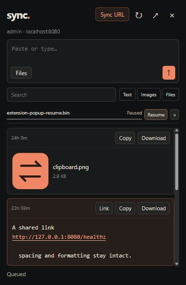

# sync.

A self-hosted, temporary shelf for moving files, images, folders, links, and text between devices on your local network. Think of a pen drive without the pen drive: send something from one device and retrieve it from another. Everything expires after 24 hours.

The web app and Chrome companion live in this repository. The interface is dark-only, with a stacked shelf, immediate file uploads, and keyboard shortcuts that keep sending quick.

## Features

- Original file and image bytes, with per-chunk and whole-file SHA-256 verification.
- Four parallel upload chunks, retries, range downloads, and a default 20 GiB file limit.
- Plain-text snippets that retain spaces, tabs, line breaks, and Unicode; clickable links open in a new tab.
- Drag-and-drop files and folders, clipboard paste, and **Ctrl/⌘ + Enter** to send a draft.
- Private uploads by default, anonymous public sharing when enabled, and username/password accounts with admin user management.
- Chrome companion with quick sends, context menus, search, category filters, and a persistent resumable transfer queue.
- Automatic 24-hour content expiry, including abandoned partial uploads.
- One Docker service and one data volume; no database, npm build, or external runtime services.

## Stack and project layout

The server uses **Go's standard library**. It embeds a plain **HTML/CSS/JavaScript** frontend, so the built executable serves the entire app. The Chrome companion is a **Manifest V3** extension using an offscreen transfer engine and IndexedDB for its queue. Production deployment uses **Docker Compose**.

| Path | Contents |
| --- | --- |
| `main.go`, `auth.go`, `extension_transfer.go` | Server, accounts, storage, integrity checks, and extension API |
| `web/` | Web interface, clipboard handling, folder packing, and upload worker |
| `extension/` | Chrome companion and its [installation guide](extension/README.md) |
| `tests/`, `*_test.go`, `testdata/` | JavaScript and Go tests and synthetic fixtures |
| `scripts/` | Extension packaging |
| `compose.yaml`, `Dockerfile`, `.env.example` | Homelab deployment and configuration |

Default runtime data, accounts, local credentials, build caches, and generated ZIPs are excluded from version control. Keep any custom data directory outside the checkout or add it to `.gitignore`.

## Run in Docker

Install Docker with the Compose plugin, then clone and start the project:

```sh
git clone https://github.com/KayVlad/sync.git
cd sync
docker compose up -d --build
```

Open **http://YOUR-SERVER-IP:8080** on each device. Allow inbound TCP 8080 on the homelab server. Public items are visible without signing in. Sign in with your username and password to upload and access your private items. There is no device pairing or extra send confirmation.

The initial username is **admin**. Retrieve its generated password before signing in:

```sh
docker compose exec sync sync admin-password
```

Keep the password in your password manager. The bootstrap password file is deleted after its first successful login. Alternatively, set `SYNC_ADMIN_USERNAME` and `SYNC_ADMIN_PASSWORD` in `.env` **before the first startup**. Any non-empty password is accepted, up to 1024 UTF-8 bytes, with no minimum length or complexity rules. Subsequent starts use the persisted accounts. To change the port or limits, copy `.env.example` to `.env` and edit it before starting.

Use HTTPS through a TLS reverse proxy for automatic clipboard previews and image copying on other devices. Plain LAN HTTP still supports sign-in, uploads, downloads, text copy, and Ctrl+V. HTTP does not encrypt files or credentials; use it only on a trusted network.

## Run locally without Docker

Install **Go 1.25 or newer**. No JavaScript dependency installation is needed. From the cloned repository:

```sh
go run .
```

Open [http://localhost:8080](http://localhost:8080). In a second terminal, before the first successful admin login, retrieve the initial password:

```sh
go run . admin-password
```

The username defaults to `admin`; there is no fixed default password. Local state is stored in `./data` and survives restarts. Stop the server with Ctrl+C. To build an executable, use `go build -o sync .` on Linux/macOS or `go build -o sync.exe .` on Windows, then run it.

Configuration comes from environment variables. `.env` is read by Docker Compose; the Go executable does not load it automatically. For example, to use another port and data directory:

```sh
# Linux/macOS
SYNC_ADDR=:8085 SYNC_DATA=./sync-data go run .
```

```powershell
# PowerShell
$env:SYNC_ADDR = ':8085'
$env:SYNC_DATA = './sync-data'
go run .
```

Use the same `SYNC_DATA` when running the `admin-password` command. Set `SYNC_ADMIN_USERNAME` and `SYNC_ADMIN_PASSWORD` before the first startup if you want your own initial credentials. Subsequent starts retain the existing accounts.

## Updating and stopping Docker

```sh
git pull --ff-only
docker compose up -d --build
docker compose logs -f
```

Reload the unpacked extension in `chrome://extensions` after updating its files. To stop the Docker service, run `docker compose down`; this retains the data volume. Avoid `docker compose down -v` unless you intend to remove all stored accounts and content.

## Chrome companion

The [Chrome extension](extension/README.md) provides server URL/username/password login and a compact scrollable shelf with Copy, Download, clickable links, public share links, search, and Text/Images/Files filters. Paste text/images into its composer and press **Ctrl/⌘ + Enter**; picked or dropped files queue immediately. **Sync it** context menus send selected text, links, original images, and direct video files. **Alt + Shift + S** sends the page selection or current URL; the address-bar keyword is `sync` + Space/Tab + a URL + Enter.

The durable queue keeps staged files in IndexedDB, survives closing the popup, and supports pause, resume, retry, and cancel. Interrupted transfers pause after a browser restart. Images captured from webpages are limited to 32 MiB; direct videos use parallel verified chunks up to the server limit, with no fixed total transfer deadline. Streaming playlists/blob playback are unsupported. Local queued data expires after 24 hours, with cleanup on next startup if Chrome is closed. Successful/cancelled sends remove their staged data.

Install it from this same checkout: open `chrome://extensions`, enable **Developer mode**, choose **Load unpacked**, and select `extension/`. Pin **sync.** and enter your server URL, username, and password. Use `http://localhost:8080` on the server machine or the homelab LAN address on another device. For a ZIP, run `./scripts/package-extension.ps1` to create `dist/sync-chrome-extension.zip`. Update the server alongside it: the extension uses separate revocable sessions, idempotent requests, and owner-only upload receipts. Passwords are never stored.



## Accounts

The small users icon opens admin user management: create accounts with passwords, edit usernames and roles, reset passwords, and delete accounts. Resetting a password signs that user out of existing sessions; an admin resetting their own password is signed back in on the current browser. Deleting a user removes their access. The last admin with a password cannot be deleted or demoted. Usernames are case-insensitive; passwords preserve spaces and Unicode exactly.

Uploads and text snippets are private to their owner by default. The Public switch on each card makes it visible and downloadable to anyone who can reach the server, including visitors without an account. Switch it off to revoke future public reads. Only the owner can change visibility or delete an item; administrators do not automatically gain access to other users’ private items. Existing items from versions without ownership remain private to administrators until an admin sets their visibility, which also assigns that admin as owner. Deleting an account does not delete its items; normal expiry still applies. A public download already in progress may finish after the switch is turned off, and downloaded copies cannot be revoked.

Passwords use PBKDF2-HMAC-SHA-256 with 600,000 iterations and a random 16-byte salt, following the [OWASP PBKDF2 guidance](https://cheatsheetseries.owasp.org/cheatsheets/Password_Storage_Cheat_Sheet.html#pbkdf2). Passwords and password hashes are never returned by the API. Browser sessions use random, hashed tokens in HttpOnly, SameSite=Strict cookies, marked Secure for HTTPS logins. These are internal session credentials; users only enter usernames and passwords. Sessions last 30 days, persist across restarts, and are capped at 20 per user. API clients POST `{ "username": "…", "password": "…" }` to `/api/auth/login` and retain the session cookie.

Login attempts are limited to 12 per minute per connecting IP, and password verification is limited to four simultaneous jobs. A reverse proxy shares the IP limit. Accounts and sessions live in `accounts.json`; they persist independently of 24-hour content retention. Up to 500 accounts are supported. Existing token-prototype accounts are migrated automatically: sessions and old login tokens are invalidated, the original admin gets a bootstrap password, and other accounts need passwords set by an admin. Shared content is retained until its normal expiry. Legacy token/basic-auth environment variables are no longer used.

```sh
docker compose logs -f
docker compose down
```

The named `sync-data` volume persists across container updates and restarts. The image runs as UID/GID 10001 with a read-only root filesystem and no Linux capabilities. Bind mounts must be writable by 10001. Only one service instance may own a data directory.

## Sending and retrieving

- Drop files anywhere on the page or click **choose files**. Upload starts immediately. Multiple selected files queue automatically.
- Drop a folder or click **folder** to send it as one uncompressed ZIP64 archive. Nested paths, Unicode names, empty files, and file bytes are preserved; download and extract it to restore the tree. Directory drag-and-drop includes empty directories; the browser's folder picker exposes files only and omits empty directories. Each folder is limited to 10,000 entries and its ZIP must fit the configured file-size limit. Preparation runs in a worker, reads files in 4 MiB blocks for ZIP checksums, and can be cancelled. The ZIP then uses the usual parallel, SHA-256-verified transfer and 24-hour expiry. Browser uploads do not preserve filesystem permissions or symlinks.
- Press **Ctrl/⌘ + V** anywhere in the workspace to detect clipboard text, images, or files. An empty composer shows a faint, local suggestion. Press **Ctrl/⌘ + Enter** or click **Send** to send it. Starting to type dismisses the suggestion; Escape dismisses it too. Pasting into existing text inserts normally, while pasted files attach to that draft.
- With clipboard-read permission already granted, the active page checks the clipboard every second and refreshes the empty composer's preview when it changes. Returning to the page or focusing the composer also checks immediately. Typed drafts are left alone; dismissed or sent suggestions stay hidden until the clipboard changes. The small clipboard button requests access if needed. Browsers require HTTPS/localhost and may require a user gesture or deny automatic access. Ctrl+V remains the fallback and OS/browser support determines which clipboard file formats are exposed. Clipboard content is never uploaded just by previewing it.
- Type text and click **Send** or press **Ctrl/⌘ + Enter**. Ordinary Enter inserts a newline.
- Start typing anywhere on the workspace to focus the composer and insert the first character. No click is needed. Existing form fields, open dialogs, selected text, shortcuts, and Space activation on buttons/links keep their normal behavior.
- Shared items appear in one stack. Each card has a top toolbar with **Copy** and **Download**, a **Link** button for public download URLs, plus owner-only **Public** and delete controls. Public cards have an orange tint. HTTP(S) and www links in text open in a new tab; text formatting and downloaded bytes remain unchanged. The trash icon deletes immediately. Other devices update through server-sent events.
- Active transfers show progress and speed. Failed chunks retry automatically; a failed file has a **Retry** button. Keep the sending tab open until **Sent** appears. Checksum verification still happens before that status.

## Byte integrity and transfer design

Stored files are never transcoded, recompressed, or resized. Image previews display the stored original; downloading returns the original bytes. A pasted image uses the bytes supplied by the OS clipboard, which can differ from the source file; upload the file when preserving that exact original matters. **Copy image** writes a still PNG to the OS clipboard, converting non-PNG images without lossy compression; animation and original-file metadata require **Download**. Image clipboard writes require HTTPS/localhost and browser support. Supported copy formats are PNG, JPEG, GIF, WebP, AVIF, and BMP; preview support depends on server/browser format detection.

Text snippets are UTF-8 and retain Unicode characters, tabs, spaces, and line breaks received from the browser. They are plain text, not rich HTML. Browsers can normalize pasted line endings. To preserve a specific original encoding, BOM, exact line endings, or rich document formatting, send the source file.

The browser uses a dedicated Web Worker and four concurrent 4 MiB chunk requests. The server supports concurrent clients, caps concurrent chunk buffers at 16 (approximately 64 MiB), and writes verified chunks directly at their final file offsets. Browser memory usage is bounded by the chunk window, rather than total file size. The worker uses incremental SHA-256; it can operate on regular LAN HTTP without requiring [Web Crypto's secure context](https://developer.mozilla.org/en-US/docs/Web/API/SubtleCrypto). When available, native Web Crypto accelerates per-chunk hashing.

Each chunk has a SHA-256 digest. On completion, the server independently hashes the entire stored file and compares it with the browser's whole-file digest. Only a match makes the file visible and marks it sent. Acknowledged chunks and metadata are persisted to disk. Completed files survive restarts; an open sending tab retries temporary server failures. Reloading the tab requires sending the file again; abandoned partial uploads expire automatically.

Downloads support HTTP byte ranges and include `X-Content-SHA256`. The server verifies stored bytes again before each download or preview, detecting at-rest corruption. This adds one disk read before the download starts, particularly noticeable with large files or slow disks. Standard browser downloads do not perform a separate application-level checksum on the receiving device; compare the downloaded file's SHA-256 with the checksum in the file-size tooltip or download response header when that is needed. HTTPS protects transport integrity on untrusted networks. Actual throughput depends on storage, browser hashing, and network capacity; four requests do not guarantee four times the speed.

## 24-hour retention

The expiry is fixed at **24 hours after sending begins**, for files, text, and partial uploads. Reads never extend it. Expired items become unavailable at the deadline. A one-second cleanup loop removes each item's entire directory, including file bytes, text, checksums, and upload metadata. Cleanup also runs during startup. Downloads are terminated at expiry.

The service must be running to physically remove files. If it is stopped at expiry, removal happens on its next start. Filesystem failures are logged and retried. Deletion is normal filesystem deletion, not forensic secure erasure; SSD wear leveling, filesystem snapshots, backups, and copies already downloaded are outside the app's control. Exclude this temporary volume from backups/snapshots if those would violate your retention needs. Access logs and file contents are not logged by the app.

## Configuration

| Variable | Default | Meaning |
| --- | --- | --- |
| `SYNC_PORT` | `8080` | Host port in Compose |
| `SYNC_ADDR` | `:8080` | Service listen address (direct execution) |
| `SYNC_DATA` | `/data` in Docker, `data` locally | Storage directory |
| `SYNC_MAX_FILE_BYTES` | `21474836480` | 20 GiB per file |
| `SYNC_MAX_STORAGE_BYTES` | `53687091200` | 50 GiB of reserved file/text storage |
| `SYNC_ADMIN_USERNAME` | `admin` | Initial admin username |
| `SYNC_ADMIN_PASSWORD` | generated | Initial admin password, used during first setup or token-account migration |

Text snippets are limited to 1 MiB. There is a 10,000-item cap including incomplete uploads. Quota is reserved when sending begins; JSON metadata and filesystem overhead are additional, so leave free space beyond the configured storage limit. Metadata for active uploads includes per-chunk hashes. `/healthz` is an unauthenticated liveness endpoint.

For a reverse proxy, preserve the request Host, allow at least 7 MiB request bodies (escaped text can exceed 1 MiB), disable buffering on `/api/events`, and allow long completion/download requests. The final checksum scan may take time on large files. An example Nginx location:

```nginx
location / {
    proxy_pass http://127.0.0.1:8080;
    proxy_set_header Host $http_host;
    proxy_http_version 1.1;
    proxy_buffering off;
    proxy_read_timeout 1h;
    client_max_body_size 7m;
}
```

## Development and verification

Go 1.25 or newer is required. The production image builds with Go 1.26.8. There are no Go or frontend package dependencies. Node 22 or newer is needed only for JavaScript tests and the extension preview harness.

```sh
go run .
go test ./...
go test -race ./...  # requires a C compiler on supported platforms
go vet ./...
node --test tests/*.test.cjs
```

The tests cover concurrent out-of-order transfers, restart recovery, idempotent retries, checksum rejection, empty files, exact text bytes, range downloads, corrupted storage, expiry, partial-upload cleanup, quota release, password hashing/login, session persistence/expiry, user CRUD, role enforcement, password-reset/session revocation, last-admin protection, login throttling, token-account migration, cross-site write protection, unsafe previews, and live updates. JavaScript tests cover clipboard suggestions, typing dismissal, page-wide typing, exact clipboard file bytes, stale-read invalidation, transfer retries/cancellation, SHA-256 against Node's independent crypto implementation, account-bound extension queues, checkpoint recovery, original video streaming, public-link access, and extension permissions. `node tests/extension-smoke.cjs` exercises the companion against a running test server using simulated Chrome APIs; it creates and removes its own transfer fixtures.
